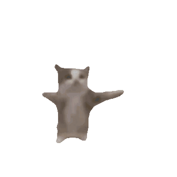

<div align="center">
  

  <h1>RouxCord</h1>
  <p><i>Un cliente de Discord para móvil, ligero y totalmente en español.</i></p>

  [](https://github.com/Cat-323/roux-bundle-esp/actions/workflows/build.yml)
  [](https://github.com/Cat-323/roux-bundle-esp/releases/latest)
  [](LICENSE)
</div>

> [!NOTE]
> **RouxCord es un fork en español de [Raincord](https://codeberg.org/raincord/rain)**, creado por cocobo1 y sus colaboradores. Todo el mérito del cliente original es suyo; este proyecto añade la marca RouxCord, la interfaz traducida y un pipeline de compilación propio. No está afiliado a Discord Inc. ni al proyecto Raincord.

## ¿Qué es esto?

Este repositorio contiene el **bundle** de RouxCord: el código JavaScript (compilado además a bytecode de Hermes) que un loader inyecta en la aplicación móvil de Discord. Incluye el sistema de plugins, temas y fuentes del proyecto original.

Qué aporta este fork:

- **Interfaz en español**: las cadenas de `src/rain/i18n/default.json` se traducen automáticamente en cada build con la API de Groq.
- **Marca RouxCord**: nombre, ajustes y actualizador propios.
- **Actualizaciones desde GitHub**: el actualizador consulta el release `latest` de este repositorio.
- **Compilación automática**: GitHub Actions compila el bundle y su bytecode de Hermes, y publica el release.

## Instalación

RouxCord necesita un loader que cargue el bundle dentro de Discord. Por ahora se usan los loaders del proyecto Raincord:

- **Android:** [rainManager](https://codeberg.org/raincord/rainManager/releases/latest)
- **iOS:** [RainTweak](https://codeberg.org/raincord/RainTweak/releases/latest)

Después, en la configuración del loader activa **Cargar desde URL personalizada** e introduce:

```
https://github.com/Cat-323/roux-bundle-esp/releases/latest/download/rain.js
```

Cada release `latest` también incluye el bytecode de Hermes (`rain.<versión>.hbc`) y un `info.json` con su hash.

> [!IMPORTANT]
> Con una URL personalizada activa, el aviso de actualización dentro de la app está desactivado. Revisa la página de [releases](https://github.com/Cat-323/roux-bundle-esp/releases/latest) para saber si hay una versión nueva.

## Compilar desde el código fuente

Requisitos: [Bun](https://bun.sh) y [Node.js](https://nodejs.org) 20 o superior.

```bash
git clone https://github.com/Cat-323/roux-bundle-esp.git
cd roux-bundle-esp
bun install

# Opcional: traducir la interfaz (necesita una clave de Groq)
GROQ_API_KEY=tu_clave node scripts/translate.mjs

# Compilar el bundle y el bytecode de Hermes (salida en dist/)
bun run build --release-branch=main --build-bytecode
```

> [!TIP]
> `translate.mjs` sobrescribe `src/rain/i18n/default.json`. Si lo ejecutas en local, no subas ese cambio: restáuralo con `git checkout src/rain/i18n/default.json`. El workflow traduce en cada build sin guardar el resultado en el repositorio.

## Compilación automática

El workflow [`build.yml`](.github/workflows/build.yml) se ejecuta al hacer push a `main`, de forma manual y cada 12 horas. En las ejecuciones programadas comprueba si [Raincord](https://codeberg.org/raincord/rain) tiene commits nuevos, los fusiona y compila solo si hay cambios. Para usarlo en tu propio fork necesitas el secreto `GROQ_API_KEY` en **Settings → Secrets and variables → Actions**.

## Créditos

RouxCord se apoya en el trabajo de [Raincord](https://codeberg.org/raincord/rain) y de todas las personas que han contribuido a él. Puedes verlas en la pantalla **Desarrolladores** dentro de la aplicación. Gracias también a los autores de los proyectos de los que Raincord, a su vez, toma ideas y código.

## Contribuir y reportar errores

Las [issues](https://github.com/Cat-323/roux-bundle-esp/issues) y los pull requests son bienvenidos. Antes de abrir una issue, comprueba que no esté duplicada y, si el fallo viene del cliente original y no de la traducción o la marca, considera reportarlo también en [Raincord](https://codeberg.org/raincord/rain/issues).

## Licencia

Distribuido bajo la **Mozilla Public License 2.0**. Consulta el archivo [LICENSE](LICENSE) para ver el texto completo. Los avisos de autoría del proyecto original se conservan.
